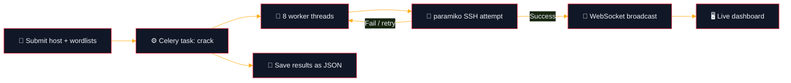

<div align="center">


<br/>


</div>


## 👋 Overview

**SSH Auth Assessment Tool** is a Django web application that tests SSH logins against username and password wordlists, so testers can check for weak or default credentials on systems they are authorized to assess. Scans run as background jobs and stream successful results to the browser live, over WebSockets.

> ⚠️ **For authorized security testing and educational use only.** Run it only against hosts you own or have written permission to test. Unauthorized access to computer systems is illegal.


## ✨ Features

<div align="center">


</div>


## 🔄 How It Works

<div align="center">


</div>



1. You submit a target host, port, and paths to a username wordlist and a password wordlist.
2. A **Celery task** queues the scan so the web page stays responsive.
3. **8 worker threads** pull passwords from a shared queue and try each username with `paramiko`, retrying on connection errors.
4. Every successful login is pushed to the browser instantly through a **Django Channels** WebSocket.
5. When the scan finishes, the results are saved as a timestamped JSON report under `app/output/`, named after the target host.


## 🛠️ Tech Stack

| Layer | Tools |
|-------|-------|
| 🌐 **Backend** | Django |
| ⚙️ **Background jobs** | Celery, Redis (broker and result backend) |
| 📡 **Real-time** | Django Channels, Daphne, WebSockets |
| 🔐 **SSH** | Paramiko |
| 🖼️ **Dashboard** | Bootstrap, Chart.js, ApexCharts |
| 🗄️ **Database** | SQLite |


## ⚙️ Getting Started

> Requires Python 3.10+ and a running **Redis** server.

```bash
# 1. Clone the repository
git clone https://github.com/martin8281/ssh-auth-assessment-tool.git
cd ssh-auth-assessment-tool/Project

# 2. (Recommended) create a virtual environment
python -m venv env
source env/bin/activate   # Windows: env\Scripts\activate

# 3. Install dependencies
pip install -r requirements.txt

# 4. Apply database migrations
python manage.py migrate
python manage.py createsuperuser   # optional, for admin access

# 5. Start Redis (if not already running)
redis-server

# 6. Start a Celery worker (in its own terminal)
celery -A Project worker --loglevel=info

# 7. Run the app
python manage.py runserver
```

Then open `http://127.0.0.1:8000` in your browser, register an account, and sign in.


## 🕹️ Usage

1. **Register** an account, then **sign in**.
2. From the **Scan** page, enter the target host, port (defaults to 22), and the paths to your username and password wordlists.
3. Start the scan. Successful logins appear in the live output as they are found.
4. Check **History** to browse past scans and their saved JSON reports.


## 📁 Project Structure

```text
Project/
├── manage.py
├── Project/                 # Django project settings
│   ├── settings.py
│   ├── urls.py
│   ├── asgi.py               # Channels entry point
│   └── celery.py
├── app/
│   ├── views.py              # Auth, dashboard, scan endpoints
│   ├── tasks.py               # Celery task: crack()
│   ├── helper.py              # SSH brute-force engine
│   ├── consumers.py           # WebSocket consumer
│   ├── routing.py             # WebSocket routes
│   ├── models.py
│   └── output/                 # Saved JSON scan reports
├── templates/                  # Dashboard, login, register, scan, history
├── static/                     # CSS, JS, chart and icon libraries
├── requirements.txt
└── assets/                     # README images
```


## ⚠️ Disclaimer

> This tool performs credential brute-forcing against SSH services. Use it **only** on systems you own or are explicitly authorized to test. Running this against systems without permission is illegal in most jurisdictions. The author is not responsible for misuse.

## 👤 Author

<div align="center">

**Martin Thomas** · M.Sc. AI & Cyber Security, CHRIST (Deemed to be University)

[](https://linkedin.com/in/martin-thomas)
[](https://github.com/martin8281)

⭐ *If you find this useful, give it a star.*


</div>
